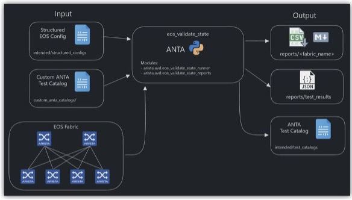
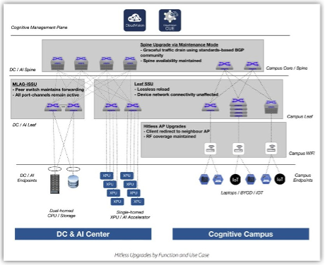
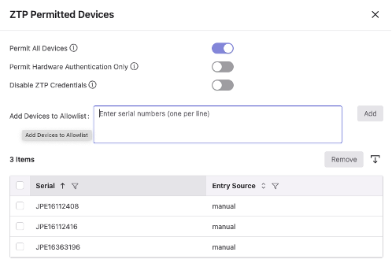
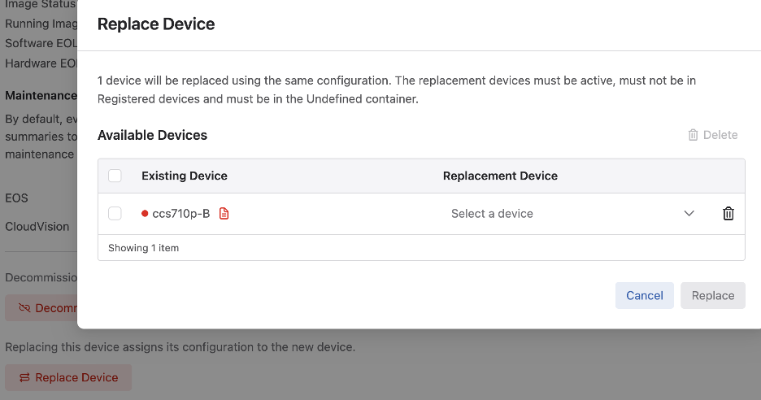
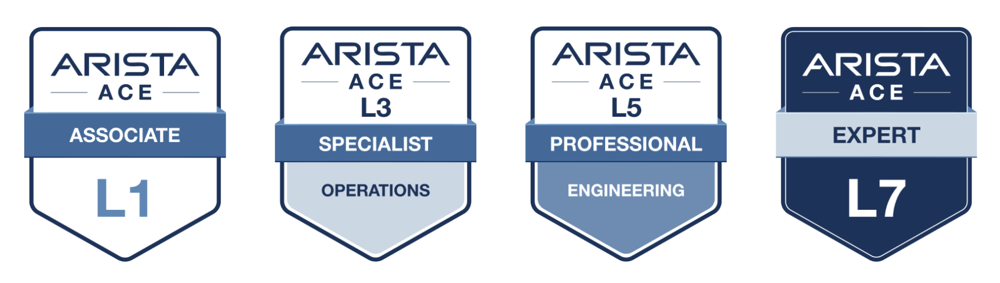

<!-- Google tag (gtag.js) -->
<script async src="https://www.googletagmanager.com/gtag/js?id=G-74HMNYLH82"></script>
<script>
  window.dataLayer = window.dataLayer || [];
  function gtag(){dataLayer.push(arguments);}
  gtag('js', new Date());
  gtag('config', 'G-74HMNYLH82');

</script>

[![Image Placement][1]][2]
[1]: img/arista-federal-logo.png
[2]: http://www.aristafederal.com

# Welcome to the October 2026 edition of the Arista Federal Newsletter, created for our valued Federal Agency and System Integrator customers.

**Innovation That Changes Industries - From Henry Ford to Arista Networks**

On October 1, 1908, Henry Ford introduced the Model T, revolutionizing the automotive industry. His vision went beyond building a better automobile. He challenged conventional thinking by embracing simplicity, standardization, and efficiency, ultimately transforming how automobiles were manufactured and delivered.

More than a century later, Arista Networks was founded on a similar belief: There had to be a better way.

Founded in 2004, Arista challenged traditional networking with a software-driven, standards-based architecture designed to deliver exceptional performance, reliability, and operational simplicity. At its core, Arista's Extensible Operating System (EOS) provides a consistent software foundation that simplifies network management, improves visibility, and reduces operational costs.

**The Next Frontier: AI for Networking & Networking for AI**

Today, Arista is bringing that same innovative thinking to Artificial Intelligence through two complementary strategies:

**AI for Networking — Smarter, Simpler, More Secure**

By combining EOS, CloudVision, advanced telemetry, and AI-driven analytics, Arista helps organizations transition from reactive troubleshooting to proactive, intelligent network operations. The result is greater visibility, stronger security, improved efficiency, and less time spent managing network complexity.

**Networking for AI — Powering the AI Revolution**

AI workloads demand extraordinary bandwidth, low latency, and massive scalability. Arista's high-performance, standards-based Ethernet platforms provide the resilient, scalable infrastructure needed to support AI training, inference, and high-performance computing without the complexity of proprietary architectures.

- **Scale Up — Maximizing AI Compute Performance:** High-bandwidth, low-latency Ethernet connectivity between AI accelerators within tightly coupled computing environments, including rack-scale systems, helping maximize GPU/XPU utilization and performance.

- **Scale Out — Building Larger AI Clusters:** High-performance Ethernet fabrics connecting thousands of AI accelerators across racks and data centers, delivering the bandwidth, intelligent load balancing, and resiliency needed for demanding AI training and inference workloads.

- **Scale Across — Connecting AI Beyond the Data Center:** Extending AI fabrics across multiple buildings, campuses, and geographically distributed data centers. 

Together, these architectures provide an open, standards-based foundation for AI infrastructure, enabling organizations to scale compute resources efficiently while maintaining operational consistency through Arista EOS.

**Different centuries. Different industries. One shared philosophy.**

Henry Ford understood that lasting innovation requires more than improving a product. It means rethinking the entire operating model to deliver better outcomes.

That same philosophy continues to drive **Arista's Modern Enterprise approach**: delivering greater capability, less complexity, and lower operational costs while enabling our Federal customers to focus on what matters most → **mission success.**

In this month’s newsletter, you’ll find:

- **Stop Fighting the Network — Focus on the Mission**

    Arista Federal Major Account Manager Daniel Lawless shares his perspective on why network engineers should focus on mission success rather than constantly troubleshooting infrastructure. Discover how Arista EOS, CloudVision, and advanced automation tools simplify network operations, enhance visibility, and deliver more predictable, secure infrastructure. **Less complexity. Less firefighting. More time focused on the mission.**

- **Zero Touch Total Domination. — Part 3: TerminAttr, ZTR & Beyond**

    In this month's Arista Federal Newsletter, **Casey Durst (SE) and Brady Schulman (ASE)** bring our three-part Zero Touch Provisioning series to a close.  Building on the fundamentals and deployment workflows covered in Parts 1 and 2, this final installment explores how **Arista CloudVision and TerminAttr** deliver continuous network visibility and management long after initial provisioning. They'll also dive into **Zero Touch Replacement (ZTR)**, demonstrating how Arista simplifies hardware replacement while preserving device identity and configuration. From initial deployment to ongoing operations and lifecycle management, discover how Arista helps Federal teams **reduce manual effort, minimize downtime, and simplify network operations** all while keeping mission-critical environments running.

We welcome your feedback, ideas, and requests for this newsletter at <fed@aristafederal.com.>

As always, thank you for your partnership and trust in Arista. We remain committed to helping our customers build secure, resilient, and modern network infrastructures that support mission success today and well into the future.


---

## **Arista Blog**

[![Image Placement][3]][4]
[3]: img/blog.png
[4]: https://blogs.arista.com/blog

---
##Stop Fighting the Network##

By Daniel Lawless

**The Reality on the Ground**

Every network engineer supporting a mission command node, an enterprise enclave, or an expeditionary tactical site knows the feeling: you’re not engineering for the mission, you’re firefighting the infrastructure.

You spend scheduled maintenance windows navigating fragmented OS releases, deciphering cryptic syslog storms, praying a route-map tweak doesn't blackhole traffic or create asymmetric routing headaches, and manually auditing configs against STIG baselines that drifted two patch cycles ago. The network is supposed to be the invisible, resilient foundation enabling mission data flow. Yet operators routinely sink up to 80% of their operational cycles just keeping it from tipping over.

It’s time to stop fighting the network. Friction isn’t the complexity of the mission; it’s the operational debt of legacy paradigms.

**The Anatomy of the Fight: How We Got Here**
In defense and federal environments, the very tools and habits used to achieve meant to guarantee are the very things that sabotage it:

- The Multi-Train Trap: Running three different software trains across campus, data center, and tactical edges means your team isn't mastering one operating system, they’re juggling divergent command syntaxes, differing bug matrices, and inconsistent feature behaviors.

- Polling in the Dark: Relying on periodic SNMP polling or fragmented syslogs means operators only discover an issue after critical mission traffic drops. When troubleshooting an intermittent route flap or microburst, the evidence is already gone.

- Tribal Knowledge vs. Standard Baselines: Configs are pushed box-by-box via manual CLI entry. Over time, devices drift into unique "snowflakes." When an outage hits, half the resolution time is spent figuring out what changed and who typed it.

- Hero Culture: When uptime depends entirely on 0200 maintenance heroics and savant-level CLI troubleshooting, the operational model is fundamentally broken.

Flipping the Script: Modern Network Automation in Action
Stopping the fight doesn't mean simplifying the mission; it means transforming the architectural foundation into something deterministic, automated, and self-healing. That transformation rests on three core pillars:

**1. One Consistent Binary Across Every Tier: EOS & NetDB**

Operational simplicity begins at the software layer. An architecture built on a single, unmodified binary across every form factor. From modular chassis in the core to compact switches at the tactical edge, eliminate the multi-train headache.

Because Arista EOS is built on NetDB (a centralized, state-sharing database rather than disjointed, competing daemons), every operational state change from interface counters to route tables, and TCAM utilization, to name a few, are streamed in real time. Operators don't have to guess what happened during a transient microburst or an intermittent flap; telemetry captures it at sub-second granularity.

**2. Design & Validate Before Deployment: AVD + ACT (Digital Twin) + ANTA (NRFU)**

Manual CLI changes should never be tested for the first time in a live production environment, especially when operational missions are on the line.

- Architect, Validate, Deploy (AVD): Shifting to declarative Infrastructure-as-Code (IaC), AVD leverages simple, human-readable data models (YAML/JSON) to automatically generate, validate, and document consistent, standards-based fabric configurations. Human typographical errors and configuration drift are engineered out before a single command runs.

- Arista Cloud Test (ACT): AVD couples directly with ACT to spin up a high-fidelity digital twin of your production topology using virtual EOS (cEOS/vEOS). Routing policies, ACLs, and failover scenarios are simulated and validated against synthetic traffic inside the twin. You verify operational success long before touching physical switches.

- Arista Network Test Automation (ANTA): Once changes are pushed, ANTA automates Network Ready for Use (NRFU) testing. Instead of operators manually typing in dozens of show commands across every box, ANTA executes structured, declarative test suites across the fabric. It validates routing tables, EVPN/VXLAN reachability, interface health, and protocol adjacencies in seconds, providing immediate, programmatic proof that the network is healthy and ready for mission data.



**Figure 1: Automated Validation & NRFU Testing with AVD and ANTA:** Structured configuration intent and custom test catalogs are executed programmatically across the EOS fabric via the ANTA runner, generating automated, audit-ready validation reports (CSV/Markdown/JSON) before live traffic is committed.

**3. Continuous Operational Assurance: CloudVision**

Once validated, day-to-day operations and change management shift into Arista CloudVision, turning reactive maintenance into continuous, policy-driven automation:

- Continuous Compliance & STIG Baselines: CloudVision continuously audits running configurations against defined STIG, security, and software baselines. The compliance dashboard highlights drift the moment it occurs and allows automated, push-button remediation, ending the cycle of panic before security inspections.

- Predictable, Hitless Upgrades: Maintenance windows no longer require downtime or late-night heroism. Utilizing Smart System Upgrade (SSU) and hitless leaf/spine maintenance modes, CloudVision gracefully diverts traffic around a target device, applies patches or software upgrades, validates health checks post-upgrade, and safely returns the node to active service, all without dropping packets.



**Figure 2: Automated Leaf Switch Maintenance Mode & Smart System Upgrade (SSU) Workflow:** CloudVision and EOS automate hitless maintenance by gracefully shifting active traffic to redundant paths, upgrading the operating system, running post-boot health verification, and returning the switch to service without dropping packets.

- Time-Machine Troubleshooting: CloudVision’s State Streaming acts as an operational DVR. When an anomaly occurs, operators can rewind the state of the entire network to the exact millisecond of the incident to inspect routing tables, buffer allocations, and environmental metrics side-by-side.

**The Operational Dividend**

When you stop fighting the network, the mission dividend is immediate:

| Legacy Reactive Operations | Modern Deterministic Networking |
| :--- | :--- |
| Fragmented OS trains & syntax divergence | Single consistent binary (EOS) from tactical edge to core | 
| Reactive SNMP polling & lost transient events | Real-time state streaming telemetry (NetDB) with historical playback |
| Box-by-box CLI & manual STIG drift audits	| Declarative Infrastructure-as-Code (AVD) & continuous compliance dashboards |
| Production testing & maintenance downtime	| Pre-flight digital twin simulation (ACT) & automated, hitless upgrades |
| High maintenance fatigue & firefighting | Predictable, validated change management & operational assurance |

**Mission Focus Over Maintenance**

Warfighters and federal mission stakeholders don't care about route reflectors, BGP attributes, or leaf-spine fabrics. They care whether imagery, intelligence feeds, voice, and mission command data arrive reliably, securely, and without delay.

Network engineers and architects should be seen as surgeons, operating with precision, deliberate methodology, and deep structural expertise, not emergency triage staff or firefighters constantly rushing to contain the next blaze. Our technical talent shouldn't be trapped in the engine room wrestling legacy technical debt.

By deploying an infrastructure built on open programmability, digital-twin validation with AVD and ACT, and continuous operational assurance through CloudVision, we remove friction from the transport layer.

Let the automation handle the plumbing. Stop fighting the network and give operators their time back to practice precision engineering and enable high-priority mission execution.

---
##Zero Touch Provisioning with Arista##
**Part Three: TerminAttr, ZTR, … and Beyond**

By Casey Durst (SE) and Brady Schulman (ASE)

We've covered the requirements and the environment build-out (Part One), and the operational mechanics of engaging, disengaging and CloudVision initial setup (Part Two). To close the series out, let's talk about how CVP actually keeps a conversation going with a switch after ZTP is complete. Then, we will discuss Zero Touch Replacement which is the piece most people ask about once they're operating a ZTP enabled network. 

**TerminAttr: How CVP Actually Talks to the Switch**

ZTP gets all the attention because it's the element that operators can see: a switch with no configuration turning into a fully managed device in minutes. But ZTP is a one-time event. The thing that makes continued operation via CVP useful on day two or day two hundred is TerminAttr.
TerminAttr (short for Terminal Attributes) is the agent that runs on the switch and streams its state. This includes interface counters, routing tables, arp tables, hardware status, configuration state, the works. All of this data is streamed to CVP continuously and efficiently using protobuf. It's not polling; it's a persistent streaming connection that sends only the changed data as it occurs. This is why CVP's dashboards feel closer to real-time than the "refresh every five minutes" model older NMS platforms used. When we say ‘state-streaming’, we actually mean the real time state of each agent on the switch viewed from one location (CVP) delivered via Terminattr. 

A few things worth knowing about TerminAttr in the context of everything we've covered so far:

- **It is installed as part of the ZTP bootstrap.** When the switch pulls its configuration from CVP during ZTP, TerminAttr comes along with it and is configured to point back at the same CVP cluster. It is bundled with EOS not installed separately! 

- **It's what makes the device show up as "streaming" in inventory,** as opposed to just present. A device could be in CVP's inventory without a healthy TerminAttr connection. Usually this occurs because of a routing or firewall problem between the switch and CVP. When that happens, you'll see the device but it will be in a stale state. If a device looks like it's "not talking," connectivity is the first thing to check. This is similar to the way DHCP and Option 67 were the first things to check during a stalled ZTP.

- **It's the same channel Change Control rides on.** When CVP pushes a configuration change, during ZTP or any ordinary day-two change, it's going out over the same connection TerminAttr established from the switch to CVP. There isn't a separate "management channel" and "telemetry channel"; it's the same pipe doing both jobs.

So the mental model is: ZTP is the one-time introduction, the CVP token and permitted-devices check are the bouncer at the door, and TerminAttr bundled within EOS is the ongoing conversation once the device is inside.

**Zero Touch Replacement (ZTR)**

Just a few short decades ago, PFC Durst was in the field and needed to change out switches as the existing device was literally covered in mud. The process was manual and time intensive which carried significant risk. The development and support for a simple, low-tech and quick replacement process is an absolute must in many operating environments. Part Two touched on device replacement in general terms. It deserves its own section, because Arista treats it as a distinct workflow, Zero Touch Replacement, rather than just "ZTP happening to run again on a new box." The distinction matters because ZTR is specifically about preserving a device's identity (hostname, management IP, interface roles, topology position) and handing it to a different physical switch rather than provisioning a new device from scratch.

**Two Scenarios Where ZTR Behaves Differently**

This is the part that trips people up, because "replace a device" covers two operationally different situations:

**Scenario A: The busted switch (unplanned, offline).** The device has already failed and dropped off the network. TerminAttr's connection is gone and CVP shows it as unreachable. There's no graceful decommission step available because the device can't participate in one; it's dead. Here, the sequence is: add the replacement's serial to the permitted list, physically swap the hardware, let ZTR bring the new device in under the old identity, confirm it's healthy, then clean up the dead device's now-orphaned inventory record. You're doing cleanup after the fact because there was no opportunity to do it before.

**Scenario B: The planned refresh (upgraded switch, still online).** This is a hardware refresh, an end-of-life swap, or a capacity upgrade where the existing device is still up and functioning right up until you pull it. This is the easier of the two because you can sequence things properly: add the new serial to the permitted list ahead of time, schedule a maintenance window, and using Studios, automatically transfer the configuration, software, and tags from the original device to the replacement device while seamlessly decommissioning the existing device. Because the old device is healthy until the moment you unplug it, you also have the option to pull its final running configuration for your records before it comes offline, something you don't get the luxury of in Scenario A.

**The Permitted Devices Requirement**

This is worth repeating because it's the step that gets missed under pressure: the replacement device's serial number has to be added to the ZTP Permitted Devices list before it will provision. ZTR doesn't bypass the allow-list gate we covered in Part Two. It uses it the same way a first-time deployment does. The only difference is that once the new switch checks in, we will map it to an existing device identity instead of creating a new one.
 


**Bringing the Replacement Into Inventory**

Once the new device's serial is permitted and it powers on connected to the same port the old device used:

1.	It goes through the same DHCP → CVP token → bootstrap sequence as any ZTP device.

2.	Once the device has ZTP’d successfully and is streaming telemetry to CVP, it becomes available to the ZTR workflow. Select the old device in inventory, click replace device, and then select the newly added device. CVP associates the incoming device with the identity of the device it's replacing: the hostname, management IP, and role-specific configuration carry over automatically rather than needing to be rebuilt.

3.	TerminAttr comes up as part of that same bootstrap, and the device starts streaming state under its new (inherited) identity.



**Putting It All Together: A Full Deployment Walkthrough**

Let's close the series by walking a single device through everything we've covered, start to finish.

**1. Staging.** The switch arrives, gets racked, powered, and connected. Remember, one cable & one port as we outlined in Part One. Its serial number has already been added to the CVP Permitted Devices list ahead of the install.

**2. Boot and DHCP.** With no startup configuration present, the switch boots directly into ZTP mode and sends a DHCP discover out every connected interface:

```
DHCPDISCOVER from 00:1c:73:xx:xx:xx via GigabitEthernet1
```

The DHCP server (configured per Part Two's sample scope) responds with an address, gateway, NTP, DNS, and Option 67 pointing to the CVP bootstrap endpoint:

option bootfile-name "https://cvp.corp.local/ztp/bootstrap";

**3. Bootstrap retrieval.** The switch makes an HTTPS request to that URL. A trimmed example of what that exchange looks like:

```
GET /ztp/bootstrap HTTP/1.1
Host: cvp.corp.local

HTTP/1.1 200 OK
Content-Type: text/plain

#!/usr/bin/env bash
#Arista ZTP bootstrap
CVP_TOKEN="eyJhbGciOiJIUzI1NiIsInR5cCI6..."
CVP_SERVER="cvp.corp.local"
...
```

That CVP token is what authenticates this request as coming from a legitimate onboarding flow.

**4. Serial validation.** CVP checks the switch's serial number against the Permitted Devices list. If it's not on the list, the process stalls here, which is exactly the allow-list behavior covered in Part Two and reiterated above under ZTR.

**5. Configuration and TerminAttr push.** With the serial validated, CVP pushes down the configuration profile assigned to that device role along with the TerminAttr agent and its pointer back to the CVP cluster. A simplified version of what gets applied:

```
hostname core-switch-04
!
interface Management1
   ip address 10.10.60.14/24
!
ip route 0.0.0.0/0 10.10.60.1
ntp server 10.10.50.6
!
daemon TerminAttr
   exec /usr/bin/TerminAttr -cvaddr=cvp.corp.local:9910 -cvauth=token,/tmp/token -smashexcludes=ale,flexCounter,hardware,kni,pulse,strata -ingestexclude=/Sysdb/cell/1/agent,/Sysdb/cell/2/agent
   no shutdown
```

**6. Apply and reboot.** The switch applies this configuration, reboots if required (typically for hostname and management interface changes), and comes back up ready to have a full configuration pushed to it. It is also possible to upgrade the switch as part of the ZTP process in order to ensure all devices meet a minimum requirement.
 
**7. Steady state.** TerminAttr establishes its streaming connection, CVP shows the device as active and streaming in inventory, and from this point forward the device is subject to normal Change Control for any future configuration work; the same governed process, whether the next change happens next week or next year.

**8. … and beyond.** From here, the device lives its normal operational life under CVP management. If it fails down the road, Zero Touch Replacement picks up exactly where this walkthrough leaves off: same permitted-devices gate, same bootstrap sequence, but landing on an inherited identity rather than a fresh one.
 
That's the series: the requirements and rationale in Part One, the environment build-out and day-to-day operational commands in Part Two, and the deeper mechanics including TerminAttr, Zero Touch Replacement, and a full walkthrough here in Part Three. The honest summary is the one we opened with back in Part One: ZTP genuinely does reduce a lot of the manual work of device deployment but it does so because the requirements behind it are well understood and consistently met, not because it's magic. Get the DHCP scope right, keep your Permitted Devices list current and understand what TerminAttr is actually doing and the "it just works" marketing line turns out to be true more often than not. Best of luck and always know your Arista team is here to support any questions or troubleshooting needed on your network. Happy Communicating!

---
## __Webinars and Events__  

<div class="grid cards" markdown>

-   __Webinars__  

    --- 

    We make is easy for you to view products that are of interest, all virtually! Technical memebers of the team showcase outstading explanation of the products. Click below to see our list of Webinars. 

    [Arista Webinars](https://www.arista.com/en/company/news/webinars){.md-button}

-   __Events__ 

    ---
    Join us in person to get a closer look in our list of produts and solution, as well as get the chance to meet members of the team. Click below to see our list of ipcoming Events. 

    [Upcoming Events](https://www.arista.com/en/company/news/events){ .md-button }


</div>


--- 

---


## __*Software Updates*__


*Stay informed on the latest software updates across all Arista products and services.*

|  Software    | Version      |  Release Date |
| :-----------: | :-----------: | :-----------: |
| __EOS__           | 4.35.6M <br> 4.34.8M <br> 4.33.10M <br> 4.36.2F | August 18th, 2026 <br> August 18th, 2026 <br> August 18th, 2026 <br> August 15th, 2026 |
| __CVP__           | Portal 2026.2.1 <br> Appliance 7.2.0 <br> Sensor 1.4.2 | September 9th, 2026 <br> July 2nd, 2026 <br> July 8th, 2026 |
| __DMF__           | 8.10.1 | September 18th, 2026 |
| __CV-CUE__         | 2026.2.0 | May 21st, 2026 |
| __Arista NDR__     | 5.3.5 | July 16th, 2025 |
| __TerminAttr__     | 1.45.1 | July 10th, 2026 |
| __VeloCloud SD-WAN__ <br>Orchestrator/Gateway/Edge | 7.0.0 | July 2026 |

[View All Latest Software Updates](https://www.arista.com/en/support/software-download){: .md-button .md-button--primary target="_blank" }


---

## __* Security Advisories and Field Notices*__


*Stay informed on the latest platform security and field notice updates. For more information on Arista's statement on AI-Enhanced Security and Resilience regarding Mythos and project Glasswing, [click here.](https://www.arista.com/assets/data/pdf/glasswing/QA-Project-Mythos-Glasswing.pdf){: target="_blank" }*

### **Security Advisories**
* To View the **Latest Arista PSIRT Advisories**, click the following link — [Arista PSIRT Advisories](https://www.arista.com/en/support/advisories-notices){: target="_blank" } <br> 

<br>

* **Are you a CloudVision Customer?** Leverage the following workflow to remediate PSIRTs affecting your EOS devices <br> 
       - Configure **Event Notifications** to be alerted as new PSIRTs are released — [CloudVision Event Notifications](https://www.arista.io/help/articles/events-configure-notifications){: target="_blank" } <br>
       - View the **Compliance Dashboard** to see a list of impacted devices, an overview of each CVE, and remediation next steps — [CloudVision Compliance Dashboard](https://www.arista.io/help/articles/devices-compliance-bug-cve){: target="_blank" } <br>
       - Upgrade EOS devices using the **Software Management Studio** to resolve threats from impacted devices — [CloudVision Software Management Studio](https://www.arista.io/help/articles/provisioning-studios-built-in-software){: target="_blank" } <br>    

<br>

* **Not a CloudVision Customer?** Leverage the Arista ANTA PSIRT CLI workflow to generate a report that illustrates which CVEs are impacting your devices — [ANTA PSIRT CLI Feature](https://anta.arista.com/stable/security-advisory/usage/){: target="_blank" } <br> 
       - Visit **Labs.Arista.com** to try out the ANTA PSIRT CLI Feature Today — [ANTA PSIRT Assessment Lab](https://labs.arista.com/labs#tech-lib-tab-no-module){: target="_blank" } <br>
<br>

### **Field Notices**
* **C-200 AP on firmware 21.4.0M-12** — [Field Notice 135](https://www.arista.com/en/support/advisories-notices/field-notice/24501-field-notice-0135){: target="_blank" } <br> *(August 19th, 2026)*
* **Deprecation of EOS SWAG rpr Redundancy Mode** — [Field Notice 134](https://www.arista.com/en/support/advisories-notices/field-notice/24450-field-notice-0134){: target="_blank" } <br> *(August 18th, 2026)*
* **CloudVision Cluster Replay CLI Commands** — [Field Notice 133](https://www.arista.com/en/support/advisories-notices/field-notice/24406-field-notice-0133){: target="_blank" } <br> *(August 6th, 2026)*

<br>

[View All of the Latest Advisories & Notices](https://www.arista.com/en/support/advisories-notices){: .md-button .md-button--primary target="_blank" }


---


## __* Product Updates*__


*Stay up to date on all new Arista Product Releases, as well as End of Sale/End of Support Notices.*

### **New Product Releases** 
* **Q2 2026** — [Ask AVA - CloudVision as a Service (beta feature)](https://www.arista.io/help/articles/overview-core-tools-ask-ava){: target="_blank" }

###  **End of Sale / End of Software Support**
* **September 17th, 2026** — [DCA-NDA-S100MB](https://www.arista.com/en/support/advisories-notices/end-of-sale/24757-end-of-sale-of-the-arista-dca-ndr-s10){: target="_blank" }


<br>

[View All Latest End of Sale & Support Notices](https://www.arista.com/en/support/advisories-notices/endofsale){: .md-button .md-button--primary target="_blank" }


---

## Did You Know? 
Arista has revamped their certifications! The new **Arista Certified Engineer (ACE)** program is now organized by specific tracks like Cloud Data Center, Campus, and Automation to better align with your job role.



[Start your ACE journey now](https://www.training.arista.com/){ .md-button .md-button--primary target="_blank" }

---
## *Your Federal Team is Here to Support Your Success.* 


---
# *Feel Free to Reach Out To Us For Your Network Needs* 
<figure markdown>
{: style="height:300px;width:800px"}  
    <figcaption></figcaption>
</figure>
We thank you for taking the time to read out newsletter today. Feel free to reach out to your SE or ASE for more information or questions regardsing your network operations. Until next month, have a good one! 