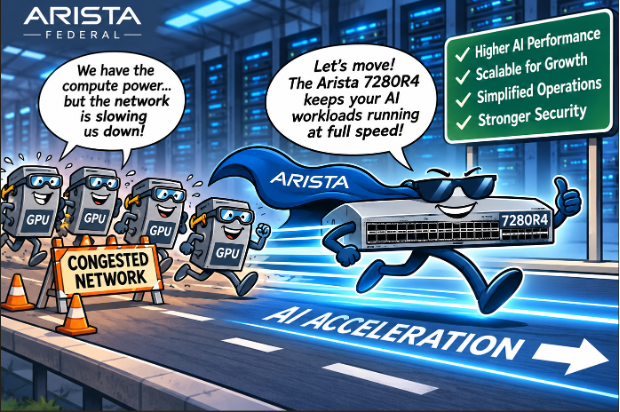
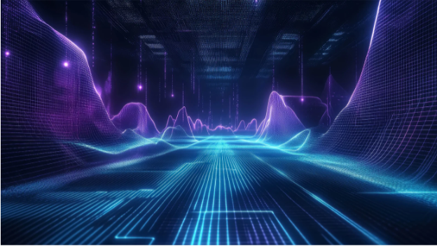
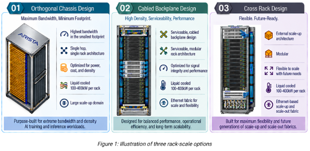
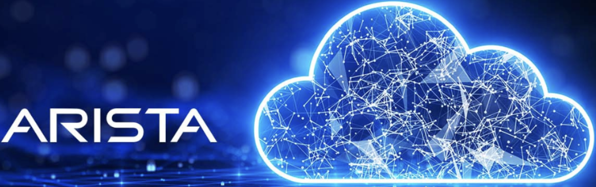
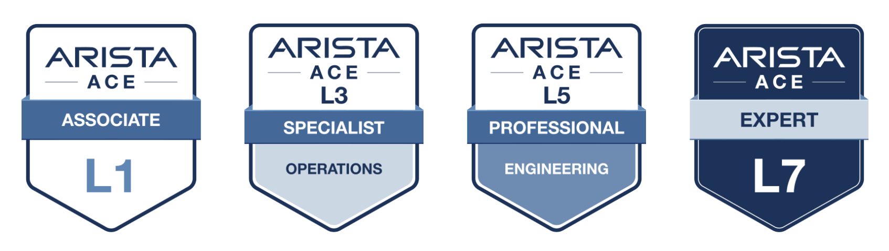
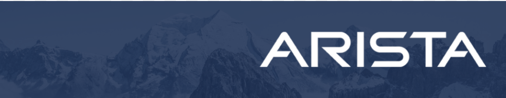

<!-- Google tag (gtag.js) -->

[![Image Placement][1]][2]
[1]: img/arista-federal-logo.png
[2]: http://www.aristafederal.com

# Welcome to the November 2026 edition of the Arista Federal Newsletter, created for our valued Federal Agency and System Integrator customers.

**Veterans Day – Honoring Those Who Served**

Each November 11, our nation pauses to honor the courage, dedication, and sacrifice of the men and women who have served in the United States Armed Forces.

Veterans Day traces its origins to **Armistice Day**, commemorating the end of World War I hostilities on November 11, 1918, at the 11th hour of the 11th day of the 11th month. President Woodrow Wilson first proclaimed Armistice Day in 1919, and it became a federal holiday in 1938. Following World War II and the Korean War, Congress officially renamed the holiday **Veterans Day in 1954**, expanding its purpose to honor American veterans of all wars and periods of service.

While both Veterans Day and Memorial Day recognize military service and sacrifice, they serve distinct purposes. **Memorial Day**, observed on the last Monday in May, specifically honors those who died while serving our country. **V**eterans Day**, observed on November 11, honors all who have served in the U.S. Armed Forces, both living and deceased, with particular emphasis on thanking living veterans for their service.

This Veterans Day, the Arista Federal Team proudly extends our deepest gratitude to our nation's veterans, including those among our colleagues, customers, and partners. Your service, commitment, and sacrifice have helped safeguard the freedoms we enjoy today.

**To all who have worn the uniform, thank you for your service.**

In this month’s newsletter, you’ll find:

- **Arista 7280R4 Series: Powering the Next Generation of AI Networking**

    AI performance is only as strong as the network behind it. In this article, **Arista Federal Client Director Kevin Carey** explores how the **Arista 7280R4 Series** helps Federal agencies, defense organizations, and Federal System Integrators maximize their AI investments. Combining high-performance 800G connectivity, intelligent traffic management, and the operational simplicity of EOS and CloudVision, the 7280R4 delivers more than just speed, it helps organizations improve AI infrastructure efficiency, strengthen cyber resilience, and build scalable, mission-ready networks. **In the AI era, the network isn't just connecting computing resources, it's enabling their full potential.**

- **Next-Gen Scale-Up Networking for AI Fabrics**

    As AI transforms Federal missions, defense systems, and critical infrastructure, the demand for scalable, high-performance networking continues to accelerate. In this Arista Blog article, **Arista's Arihant Jain and Vijay Vusirikala** discuss how next-generation scale-up networking is reshaping AI infrastructure through open, Ethernet-based architectures that deliver greater performance, flexibility, and resilience while avoiding proprietary vendor lock-in. **Their insights highlight how Arista is helping lead the evolution of AI networking to support increasingly demanding workloads and future mission requirements.**

We welcome your feedback, ideas, and requests for this newsletter at <fed@aristafederal.com.>

As always, thank you for your partnership and trust in Arista. We remain committed to helping our customers build secure, resilient, and modern network infrastructures that support mission success today and well into the future.

---

## **Arista Blog**

[![Image Placement][3]][4]
[3]: img/blog.png
[4]: https://blogs.arista.com/blog

---
##Arista 7280R4 Series: Powering the Next Generation of AI Networking##

By Kevin Carey – Arista Federal Client Director

**Delivering the Performance, Resilience, and Security Required for AI-Driven Federal Missions**

Artificial Intelligence is transforming how Federal agencies, defense organizations, and Federal System Integrators operate. As organizations invest heavily in GPUs, accelerators, and advanced computing platforms, an equally important consideration is often overlooked: **AI performance depends not only on computing power, but also on how efficiently data moves across the network.**

AI workloads generate enormous volumes of traffic between computing resources, creating significant demands on network bandwidth, congestion management, and reliability. When the network becomes a bottleneck, expensive computing resources spend valuable time waiting for data rather than processing it, reducing efficiency and the return on AI investments.

**For Federal customers, the challenge is straightforward: How do you ensure your network keeps pace with AI investments without introducing unnecessary complexity, cost, or operational risk?**

Arista's 7280R4 Series is designed to address that challenge.

**Arista 7280R4: More Than Just a Faster Switch**

The Arista 7280R4 Series combines high-density 800GbE connectivity, up to 25.6 Tbps (51.2 Tbps Full Duplex) of line-rate, non-blocking throughput, with up to 32 ports of 800GbE of switching capacity, and intelligent deep-buffer architecture to deliver the performance and scalability required for demanding AI, cloud, and high-performance computing environments.

However, the real value extends beyond technical specifications. The 7280R4 helps organizations maximize AI infrastructure investments, simplify operations, strengthen security, and prepare for future growth.

Three capabilities make the platform particularly compelling for Federal customers.

1. Maximizing AI Infrastructure Performance

    AI workloads generate significant bursts of network traffic as GPUs and other computing resources exchange data. Without effective traffic management, congestion can slow processing and reduce overall computing efficiency.

    The 7280R4 combines high-bandwidth connectivity with intelligent deep buffering and advanced congestion management to help minimize packet loss and maintain more predictable performance.

    **The business value is simple: Keep expensive AI computing resources processing information rather than waiting for the network.**

2. Protecting Investments While Preparing for the Future

    AI technology is evolving rapidly, and Federal organizations need infrastructure that can grow without constant redesigns or disruptive technology transitions.

    With flexible connectivity ranging from 25GbE to 800GbE and support for high-density 400G/800G DWDM, the Arista 7280R4 enables organizations to expand, modernize, and simplify existing network infrastructure while reducing operational complexity and costs. This flexibility helps protect existing investments while providing a scalable, future-ready foundation for next-generation AI infrastructure.

    Arista's open, Ethernet-based approach also provides flexibility across computing platforms and technology vendors, helping organizations avoid unnecessary proprietary dependencies.

    **The objective is not simply to build a faster network today, but to establish an architecture capable of supporting tomorrow's AI requirements.**

3. Simplifying Operations While Strengthening Security

    Performance alone is not enough. Federal organizations must also manage operational costs, cybersecurity requirements, and infrastructure complexity.

    The 7280R4 runs Arista EOS, providing the same consistent, highly resilient network operating system used across Arista's broader portfolio. Combined with Arista CloudVision, organizations gain centralized visibility, automation, analytics, and simplified network management.

    The platform also supports hardware-based encryption technologies, including MACsec, IPsec, and VXLANsec, helping protect sensitive data moving across the infrastructure.

    For Federal customers, this combination of performance, security, and operational consistency can help reduce administrative overhead, strengthen cyber resilience, and support Zero Trust initiatives.

**Why This Matters for Federal Customers**

Federal AI initiatives are ultimately about improving mission outcomes, whether accelerating intelligence analysis, supporting digital engineering, strengthening cybersecurity, or enabling advanced simulations.

At the same time, agencies and defense contractors face constrained budgets, limited IT resources, increasing cybersecurity demands, and pressure to modernize aging infrastructure.

The 7280R4 helps address these challenges by delivering greater AI infrastructure efficiency, improved scalability, simplified operations, integrated security, and long-term investment flexibility.

For Federal System Integrators, these same capabilities support the delivery of scalable AI solutions that are easier to integrate, manage, and sustain throughout their lifecycle.

**The Arista Advantage: Building AI Infrastructure That Delivers Mission Value**

One of Arista's greatest strengths has always been its ability to combine high-performance networking with software quality, architectural consistency, and operational simplicity.

The 7280R4 builds on that foundation, bringing together high-density 800G networking, intelligent traffic management, EOS, and CloudVision in a scalable Ethernet-based architecture.

As AI continues to evolve, the network is becoming a critical component of the computing environment itself. Organizations must look beyond GPUs and processing power to ensure their infrastructure can support these investments efficiently, securely, and at scale.

**For Arista Federal customers, the opportunity is not simply to deploy faster switches. It is to build a more efficient, resilient, and future-ready AI infrastructure that maximizes technology investments while supporting critical mission objectives.**

Ultimately, AI success will depend not just on how much computing power an organization deploys, but on how effectively those resources work together.

**Arista is helping to make that possible.**

**Arista Technical References**
- [Arista 7280R4 Series Product Overview](https://www.arista.com/en/products/7280r4-series)

- [Arista 7280R4 Technical Datasheet](https://www.arista.com/assets/data/pdf/Datasheets/7280R4-Series-Datasheet.pdf)

- [Arista Extends Data Center and AI Leadership](https://blogs.arista.com/blog/arista-extends-dc-ai-leadership-with-new-platforms-higher-speed)

---
##Next-Gen Scale-Up Networking for AI Fabrics##

By: Arihant Jain (Arista Senior Product Manager • Customer Engineering)
Vijay Vusirikala (Arista Distinguished Leader - AI Systems • Customer Engineering)

AI infrastructure is exploding beyond single-server boundaries. As models grow and workloads demand tightly synchronized communication across larger accelerator pools, local PCIe, CXL, and proprietary interconnects are no longer sufficient as the primary scale-up mechanism. They remain important within the server, but can create constrained compute islands across accelerator generations, system designs, and vendors. Operators are moving toward rack-scale scale-up domains, interconnecting tens to hundreds of XPUs across enclosures with high-bandwidth, low-latency links to operate as a single, tightly coupled supercomputing instance.

Expanding scale-up domains to hundreds of XPUs fundamentally shifts connectivity demands and creates a new compute+network-centric paradigm. The network is no longer simply the fabric between servers; it becomes part of the compute system itself. Just as Ethernet has become the leading open foundation for AI scale-out fabrics, the industry is now advancing Ethernet-based scale-up solutions for performance, openness, interoperability, and ecosystem choice.

**Evolution from Server I/O → Rack-Scale**

Recognizing the critical need for an open scale-up ecosystem, Arista galvanized the Ethernet for Scale-Up Networks (ESUN) initiative within OCP as a founding member alongside industry leaders such as Broadcom, Meta, and Microsoft. ESUN is focused on open Ethernet switching and framing for tightly coupled AI fabrics, including lossless delivery, error resiliency, and scale. A rack-scale scale-up fabric must deliver:

- High Radix & Single-Hop Topologies: Support scale-up domains spanning beyond 72 or 144 XPUs to hundreds and ultimately thousands of accelerators while minimizing hop count.
- Lossless Transport for Low Latency: Incorporating congestion control ensures deterministic, in-order packet delivery for tensor-parallel collective operations without tail-latency spikes.
- Reliable 200G/Lane Systems: Engineered specifically for 224G (and beyond) signaling, optimizing Signal Integrity (SI) and Power Integrity (PI) while deploying advanced liquid cooling for high-density.
- Advanced Diagnostic and Telemetry: A robust hardware diagnostic and telemetry layer to guarantee bit-error correction, secure boot, and physical validation whether running Arista EOS® or an open NOS like SONiC.
- Robust and Resilient NOS: Massive bandwidth demands and XPU uptime require modern, robust, secure, battle-tested software running atop the network.

**Three Rack-Scale Options**

To accommodate diverse datacenter footprints, thermal profiles, and accelerator architectures, Arista has pioneered three specialized liquid-cooled physical scale-up rack solutions in partnership with AMD, Arm, Broadcom, d-Matrix, Meta, Microsoft, and Qualcomm. Inspired by OCP’s open infrastructure direction, these designs provide a flexible path to integrate compute, networking, power, and liquid cooling across evolving high-density AI deployments.

1. Orthogonal Chassis Design: Using direct orthogonal connectivity between accelerator and switch blades, supporting accelerator density of 144 XPUs in 100 kW to 400 kW direct liquid cooling envelopes.

2. Cabled Backplane Design: Combines a high-density cabled backplane with a modular rack structure to enable a highly serviceable design.

3. Cross-Rack Design: A modular architecture providing maximum flexibility to scale compute and networking across multi-rack deployments, enabling larger scaling domains across scale-up and scale-out.
 

**Arista Etherlink for Scale-Up: Supporting 144 Accelerators and Beyond**

Arista's rack-scale Etherlink network architecture, designated as **Etherlink SU-144**, supports unified scale-up domains of up to 144 accelerators. With a cross-rack scale-up architecture, the number of XPUs grows to 1024 using multi-rack interconnects. Arista’s open architecture stands in contrast to proprietary scale-up configurations based on a locked-in accelerator and interconnect ecosystem. ESUN provides network operators flexibility across accelerators, switching silicon, optics, physical rack designs, and network software while retaining the high bandwidth, low latency, and reliable in-order delivery required for collective communication.

**The Powerful Role of Diagnostics**

At rack scale, raw bandwidth only matters if the physical system can be validated, monitored, and serviced predictably. Arista Netdi (Network Diagnostics Infrastructure) provides a common diagnostics and telemetry foundation at both the switch and rack level. Built on more than 8,000 person-years of development, it provides deep hardware-level validation, signal integrity analysis, secure boot attestation, and Single Event Upset (SEU) resiliency, supporting rich telemetry for the switch, physical optics, power shelves, and liquid cooling infrastructure. Netdi is entirely NOS-agnostic, giving customers full operational insight no matter which NOS they run. While Arista champions the freedom of NOS choice, Arista’s EOS remains the industry's leading resilient, secure NOS across all AI fabric roles, including scale-up networks, especially in an era of AI-enabled adversaries looking to exploit software vulnerabilities. 

Arista provides an open path for cloud and enterprise operators to scale heterogeneous AI supercomputing infrastructures without vendor lock-in. It achieves this by combining standards-based ESUN transport, flexible physical topologies spanning orthogonal, cabled backplane, and cross-rack architectures, Etherlink SU-144 scale-up domains, and Arista Netdi™ hardware diagnostics. Welcome to the new era of rack scale-up networking!

**References**

[AI Innovators video](youtube.com/watch?si=7LhY0Y_3RZX8gBr_&v=FzwydqLKHxI&feature=youtu.be)

[The Many Facets of AI Fabrics](https://blogs.arista.com/blog/the-many-facets-of-ai-fabrics)

[AI white paper](https://www.arista.com/assets/data/pdf/Whitepapers/AI-Network-WP.pdf)

[Netdi white paper](https://www.arista.com/assets/data/pdf/Arista-Netdi-Whitepaper.pdf)

[Infrastructure Security Webinar](https://www.arista.com/en/24739-keys-to-the-kingdom-webinar)

[Press Release](https://www.arista.com/en/company/news/press-release/24818-pr-20261007)

---
## __*Upcoming Events*__  
Arista hosts various events throughout the year for you! Members of our team organize these informative events to showcase Arista's ability to not only help improve your network, but to also assist by providing a set of tools to improve your operations!  

Click on the boxes below to be directed to Arista's website for additional lists of Webinars and Events.

-   __Webinars__  

    --- 

    We make it easy for you to view products that are of interest, all virtually! Technical members of the team showcase outstanding explanations of the products. Click below to see our list of Webinars. 

    [Arista Webinars](https://www.arista.com/en/company/news/webinars){.md-button target="_blank"}

-   __Events__ 

    ---
    Join us in person to get a closer look at our list of products and solutions, as well as get the chance to meet members of the team. Click below to see our list of upcoming Events. 

    [Upcoming Events](https://www.arista.com/en/company/news/events){ .md-button target="_blank" }

--- 

## __*Software Updates*__

*Stay informed on the latest software updates across all Arista products and services.*

|  Software    | Version      |  Release Date |
| :-----------: | :-----------: | :-----------: |
| __EOS__           | 4.34.9M   4.33.11M   4.35.7M | October 15th, 2026   October 15th, 2026   October 14th, 2026 |
| __CVP__           | Portal 2026.3.0.1   Appliance 7.2.0   Sensor 1.4.3 | October 27th, 2026   July 2nd, 2026   September 3rd, 2026 |
| __DMF__           | 8.9.1 | October 20th, 2026 |
| __CV-CUE__         | 2026.3.0 | October 12th, 2026 |
| __Arista NDR__     | 5.3.5 | July 16th, 2025 |
| __TerminAttr__     | 1.46.2 | October 12th, 2026 |
| __VeloCloud SD-WAN__  Orchestrator/Gateway/Edge | 7.0.0 | July, 2026 |

[View All Latest Software Updates](https://www.arista.com/en/support/software-download){: .md-button .md-button--primary target="_blank" }

---

## __* Security Advisories and Field Notices*__

*Stay informed on the latest platform security and field notice updates. For more information on Arista's statement on AI-Enhanced Security and Resilience regarding Mythos and project Glasswing, [click here.](https://www.arista.com/assets/data/pdf/glasswing/QA-Project-Mythos-Glasswing.pdf){: target="_blank" }*

### **Security Advisories**
* To View the **Latest Arista PSIRT Advisories**, click the following link — [Arista PSIRT Advisories](https://www.arista.com/en/support/advisories-notices){: target="_blank" }   

 

* **Are you a CloudVision Customer?** Leverage the following workflow to remediate PSIRTs affecting your EOS devices   
       - Configure **Event Notifications** to be alerted as new PSIRTs are released — [CloudVision Event Notifications](https://www.arista.io/help/articles/events-configure-notifications){: target="_blank" }  
       - View the **Compliance Dashboard** to see a list of impacted devices, an overview of each CVE, and remediation next steps — [CloudVision Compliance Dashboard](https://www.arista.io/help/articles/devices-compliance-bug-cve){: target="_blank" }  
       - Upgrade EOS devices using the **Software Management Studio** to resolve threats from impacted devices — [CloudVision Software Management Studio](https://www.arista.io/help/articles/provisioning-studios-built-in-software){: target="_blank" }      

 

* **Not a CloudVision Customer?** Leverage the Arista ANTA PSIRT CLI workflow to generate a report that illustrates which CVEs are impacting your devices — [ANTA PSIRT CLI Feature](https://anta.arista.com/stable/security-advisory/usage/){: target="_blank" }   
       - Visit **Labs.Arista.com** to try out the ANTA PSIRT CLI Feature Today — [ANTA PSIRT Assessment Lab](https://labs.arista.com/labs#tech-lib-tab-no-module){: target="_blank" }  
 

### **Field Notices**
- **issue triggering a reboot of the switch after 1042 days of uptime** — [Field Notice 0142](https://www.arista.com/en/support/advisories-notices){: target="_blank" }   *(October 15th, 2026)*
- **CVA Appliance Host Resource Reservation** — [Field Notice 0141](https://www.arista.com/en/support/advisories-notices){: target="_blank" }   *(October 12th, 2026)*
- **CVP On-Prem Data Retention** — [Field Notice 0140](https://www.arista.com/en/support/advisories-notices){: target="_blank" }   *(October 9th, 2026)*
- **Migration of Wi-Fi services from arista.com to arista.io** — [Field Notice 0139](https://www.arista.com/en/support/advisories-notices){: target="_blank" }   *(October 8th, 2026)*
- **Change in defaults of configuration options in CV-CUE after 15th January, 2027** (SSID profiles and Access Point Groups) — [Field Notice 0138](https://www.arista.com/en/support/advisories-notices){: target="_blank" }   *(October 8th, 2026)*
- **New EOS image signing key** (This applies to platforms running EOS 4.30.1F or earlier versions that have Secure Boot enabled) — [Field Notice 0137](https://www.arista.com/en/support/advisories-notices){: target="_blank" }   *(October 7th, 2026)*

 

[View All of the Latest Advisories & Notices](https://www.arista.com/en/support/advisories-notices){: .md-button .md-button--primary target="_blank" }

---

## __* Product Updates*__

*Stay up to date on all new Arista Product Releases, as well as End of Sale/End of Support Notices.*

### **New Product Releases** 
* **Q4 2026** — [Rack-Scale Architectures for Scale-Up and Scale-Out AI Fabrics ](https://www.arista.com/en/company/news/press-release/24818-pr-20261007 ){: target="_blank" }

###  **End of Sale / End of Software Support**
- **October 27th, 2026** — [DCA-DM-AN660](https://www.arista.com/en/support/advisories-notices/endofsale){: target="_blank" }
- **October 23rd, 2026** — [EOS-4.31 Train](https://www.arista.com/en/support/advisories-notices/endofsale){: target="_blank" }
- **October 6th, 2026** — [2025.1 Train](https://www.arista.com/en/support/advisories-notices/endofsale){: target="_blank" }

 

[View All Latest End of Sale & Support Notices](https://www.arista.com/en/support/advisories-notices/endofsale){: .md-button .md-button--primary target="_blank" }

---

## Did You Know? 
Arista has revamped their certifications! The new **Arista Certified Engineer (ACE)** program is now organized by specific tracks like Cloud Data Center, Campus, and Automation to better align with your job role.

[Start your ACE journey now](https://www.training.arista.com/){ .md-button .md-button--primary target="_blank" }

---
## *Your Federal Team is Here to Support Your Success.* 

---
# *Feel Free to Reach Out To Us For Your Network Needs* 
<figure markdown>
{: style="height:300px;width:800px"}  
    <figcaption></figcaption>
</figure>
We thank you for taking the time to read out newsletter today. Feel free to reach out to your SE or ASE for more information or questions regardsing your network operations. Until next month, have a good one! 